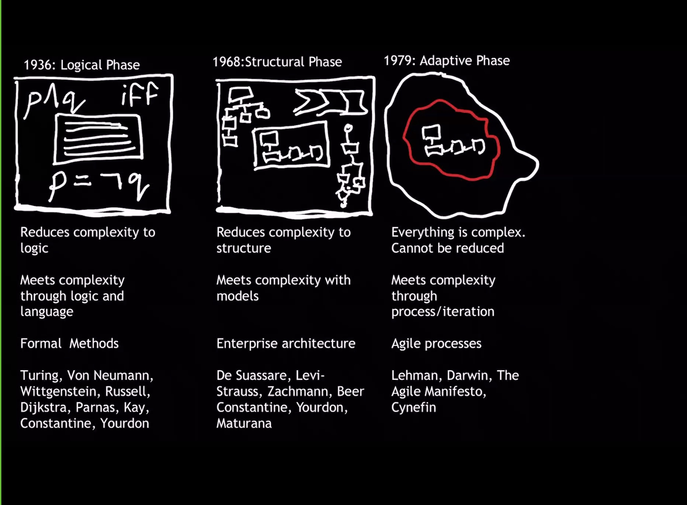
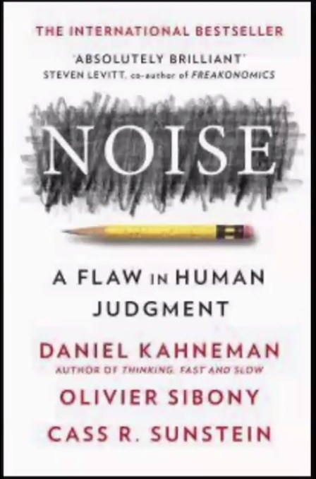
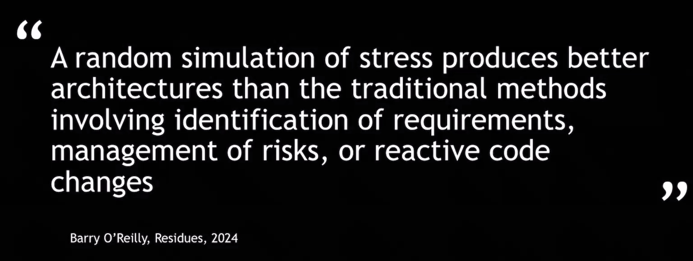
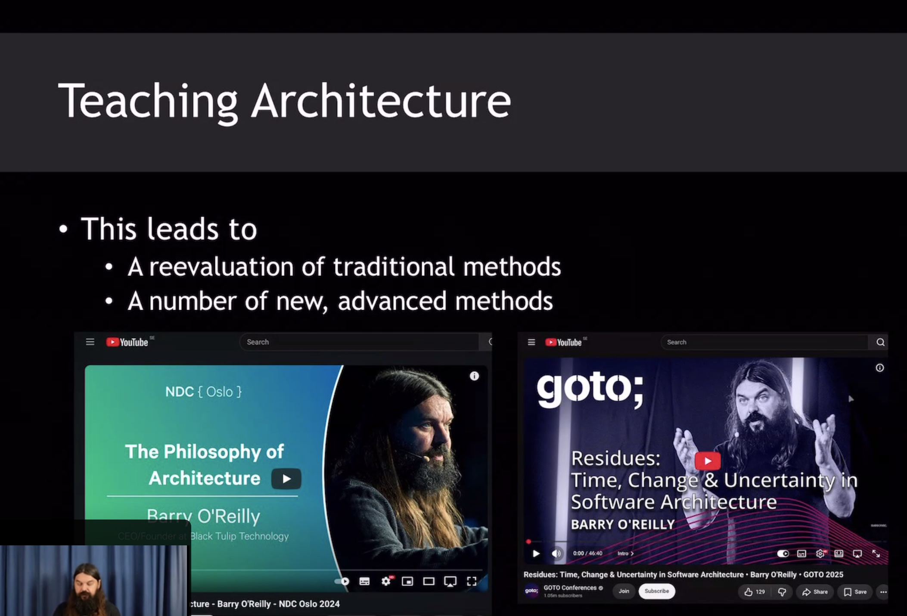
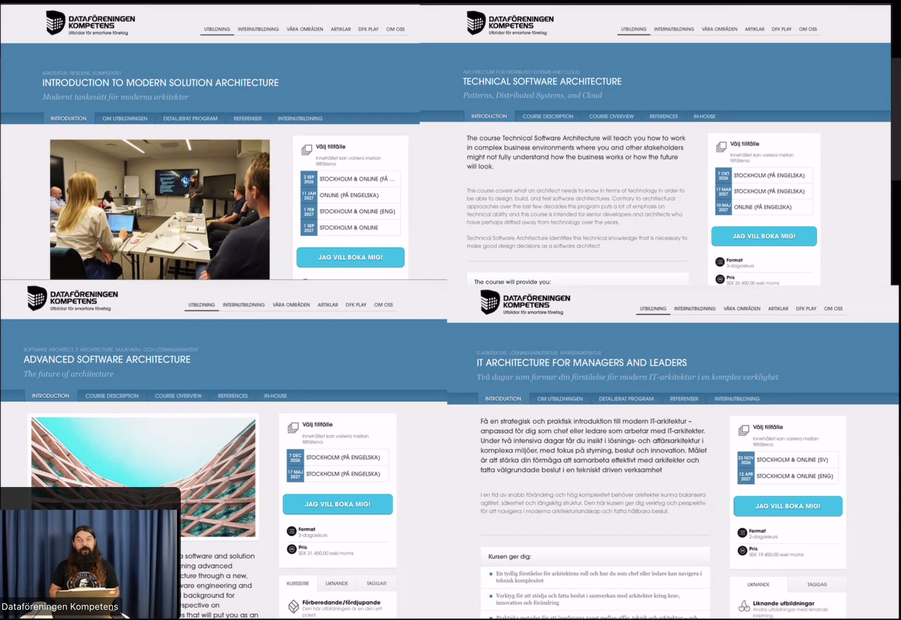

# Architecture in age of GenAI

Barry O'Reilly

- Spec Driven Development
  - As defined by write everything up in advance
    - Not really the definition IMO

History
- 1936 Logic phase
- 1968 Structural Phase
- 1979 Adaptive Phase

Now
- 2015 Residual Phase

Recommended book for architectes, Noise:

Our job as architects:
- Establish technical description
- Problem arises when that software has to live and adapt to the reality

Hyperliminal Systems

## The Walking Theory of Architecture

Take TDD, how many of succesful projects has been using TDD? - Close to 0%, maybe 5%. 95% did not use TDD

--> No tools are strictly necessary for successful architecure

--> Any tool that are used to "take a walk in the bubble" give you an understanding of the problem bubble - bubble of flux.

## Random Stressing

Any event that stresses the architecture, produces better architecture

## Residual Phase

Residuality Theory

## Youtube

- The Philosophy of Architecture - Barry O'Reilly - NDC Oslo 2024: https://www.youtube.com/watch?v=H8ZOp8ayluU
- Residues: Time, Change & Uncertainty in Software Architecture - Barry O'Reilly - GOTO 2025: https://www.youtube.com/watch?v=D8qQUHrksrE

## DF

